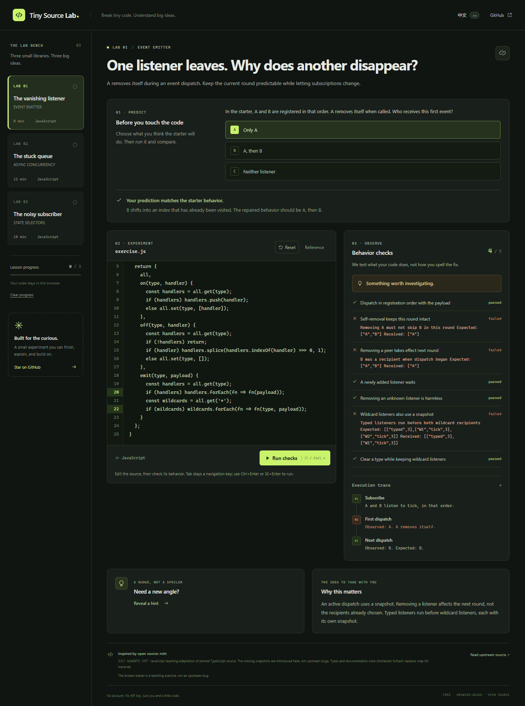

# Tiny Source Lab · 源码实验室

**改一小段代码，理解一个关键机制。**

把 mitt、p-limit、Zustand 中值得学习的机制变成浏览器实验：先预测，观察失败，修改代码，再用行为检查验证。首版有三个完整专题，无需注册或 AI API Key。

[在线体验](https://kunkun-11.github.io/tiny-source-lab/) · [English](README.md) · [贡献课程](CONTRIBUTING.md)



## 为什么删掉一次数组复制，另一个监听器就不执行了？

事件派发过程中，A 取消自己的订阅。如果直接遍历原数组，数组位置改变，B 就可能被跳过。mitt v3.0.1 在派发时复制数组；实验课故意移除这个保护，让你亲自理解它的作用。

**练习错误是人为设置的，不是上游项目的 bug。**

| 专题 | 学会什么 |
| --- | --- |
| 事件派发快照 | 监听器移除、注册顺序与通配监听器的边界行为 |
| 异步并发限制 | 任务失败后释放槽位、队列继续执行与错误传递 |
| 状态选择订阅 | 用选择器避免无关更新通知，保留前后值与取消订阅 |

页面包含预测题、可编辑源码、渐进提示、参考解答、真实运行轨迹和行为检查。中英文可切换，代码和进度保存在当前浏览器，课程链接可以直接分享。查看参考解答会被记录，检查通过是学习反馈。

并发与状态实验是独立编写的简化教学实现，不能代替生产库。来源版本、简化范围及许可见 [THIRD_PARTY_NOTICES.md](THIRD_PARTY_NOTICES.md)。

## 本地运行

需要 Node.js 20.19+ 或 22.12+，CI 使用 Node 22。

```sh
git clone https://github.com/kunkun-11/tiny-source-lab.git
cd tiny-source-lab
npm ci
npm run dev
```

打开 Vite 输出的地址。`npm run build` 生成 `dist/` 静态站点，`npm run preview` 预览构建结果。页面运行不依赖 CDN 或外部 API，不上传你的练习代码，也不采集分析数据。

验证：

```sh
npm test
npx playwright install chromium firefox
npm run test:browser
npm run build
```

参考解答必须通过，初始错误与常见错误修复必须被识别；浏览器检查会覆盖实际执行与桌面、Firefox、手机视口。部署前 CI 重复验证。

## 执行范围

代码在不透明来源的沙箱 iframe 内，通过可销毁的 Web Worker 执行。内容策略阻止网络访问，Worker 不能直接访问应用界面或本地存储。整次运行最多八秒，单项异步检查也有超时。

这是精选课程的本地学习工具，不是托管任意不可信程序的服务。检查通过不代表所有输入都正确，也不是防篡改认证；大量内存分配仍可能占用浏览器资源。

欢迎贡献讲解、反馈或一个经过验证的新课程。觉得有帮助可以 star，方便以后再找到。选题依据与后续发布计划见 [研究记录](docs/RESEARCH.md) 和 [发布草稿](docs/LAUNCH.md)。

想把这次修复讲给别人看？配套的 [PatchStage 工作台](https://kunkun-11.github.io/patchstage/) 可以把真实检查画面和选定 diff 做成可编辑的展示卡片。[查看示例](https://kunkun-11.github.io/patchstage/samples/example-card.png) 或 [项目源码](https://github.com/kunkun-11/patchstage)。

项目采用 MIT 许可，改写的上游源码保留各自署名和许可。
